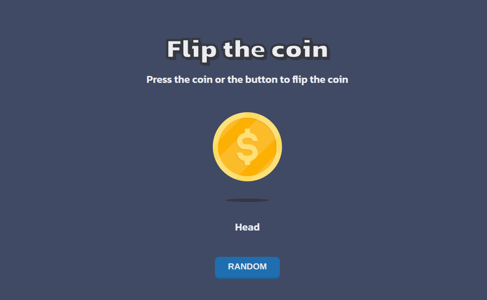

<!-- Please update value in the {}  -->

<h1 align="center">Flip the coin game | devChallenges</h1>

<div align="center">
   Solution for a challenge <a href="https://devchallenges.io/challenge/flip-the-coin" target="_blank">Flip The Coin</a> from <a href="http://devchallenges.io" target="_blank">devChallenges.io</a>.
</div>

<div align="center">
  <h3>
    <a href="{https://your-demo-link.your-domain}">
      Demo
    </a>
    <span> | </span>
    <a href="{https://your-url-to-the-solution}">
      Solution
    </a>
    <span> | </span>
    <a href="https://devchallenges.io/challenge/flip-the-coin">
      Challenge
    </a>
  </h3>
</div>

<!-- TABLE OF CONTENTS -->

## Table of Contents

- [Overview](#overview)
  - [What I learned](#what-i-learned)
  - [Useful resources](#useful-resources)
- [Built with](#built-with)
- [Features](#features)
- [Contact](#contact)
- [Acknowledgements](#acknowledgements)

<!-- OVERVIEW -->

## Overview



This project is a simple coin-flipping game developed as a solution to the Flip The Coin challenge from devChallenges.

This coin-flip project is a simple demonstration of using HTML, CSS, and JavaScript. Basically, it was a challenge to take my first steps in JavaScript, seeking to understand the concepts of `querySelector`, `getElementById`, `if`, `else`, and manipulating HTML tag components.

This project was also a way to practice HTML and CSS skills, aiming to further understand the basic concepts of syntax

### What I learned

During this project, I practiced structuring a product page and adapting its layout to different screen sizes:

- **Query selector:** `QuerySelector` was used to search within the DOM. 
  ```
  const coinAreaText = document.querySelector('.coin-area');
  ```
- **Get element by ID:** `getElementById` was used to search within the DOM using the ID declared directly on the HTML tag.
  ```
  document.getElementById('coin');
  ```
- **Conditional:** The application of `if` and `else` conditionals to alter HTML tag properties.
  ```
  if (result === 'Heads') {
      randomImage.src = 'resources/heads.svg';
      coinAreaText.lastElementChild.innerText = 'Head';
  } else {
      randomImage.src = 'resources/tails.svg';
      coinAreaText.lastElementChild.innerText = 'Tail';
  }
  ```
- **Random numbers:** Using `Math.random()` to generate random coin-flip results.

  ```
  const result = Math.random() < 0.5 ? "Heads" : "Tails";
  ```
- **Flexbox:** Organizing and aligning elements using CSS Flexbox.

### Useful resources

- [MDN - Math.random()](https://developer.mozilla.org/en-US/docs/Web/JavaScript/Reference/Global_Objects/Math/random) - Helped me understand how to generate random numbers in JavaScript.
- [MDN - addEventListener()](https://developer.mozilla.org/en-US/docs/Web/API/EventTarget/addEventListener) - Reference for handling user interactions through events.
- [MDN - DOM Manipulation](https://developer.mozilla.org/en-US/docs/Web/API/Document_Object_Model) - Helped me understand how to select and update HTML elements.
- [MDN - CSS Media Queries](https://developer.mozilla.org/en-US/docs/Web/CSS/CSS_media_queries/Using_media_queries) - Reference for implementing responsive layouts.

### Built with

- Semantic HTML5 markup
- CSS custom properties
- CSS Flexbox
- CSS Media Queries
- JavaScript
- DOM Manipulation
- Google Fonts (Kanit)

## Features

- Randomly generates Heads or Tails results.
- Updates the coin image according to the generated result.
- Displays the corresponding result text.
- Prevents unnecessary image and text updates when the result is the same as the current one.
- Responsive layout for different screen sizes.
- Custom typography and visual effects.

This application/site was created as a submission to a [DevChallenges](https://devchallenges.io/challenges-dashboard) challenge.

## Acknowledgements

- [devChallenges.io](https://devchallenges.io/) for providing the challenge and helping me improve my frontend development skills.
- [MDN Web Docs](https://developer.mozilla.org/) for the documentation and learning resources.

## Author

- Coded by **Victor C. Ricci**
- GitHub [@victorricci23](https://github.com/victorricci23)
